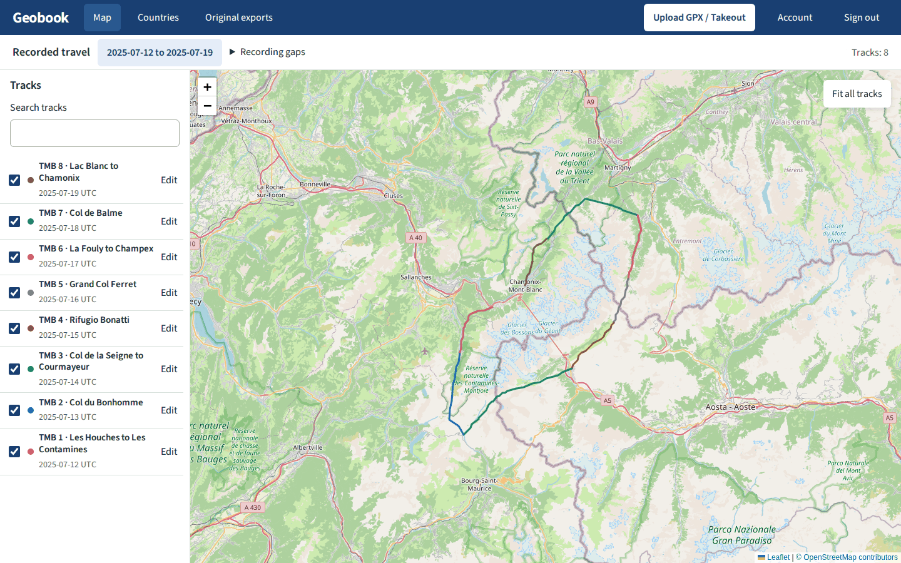
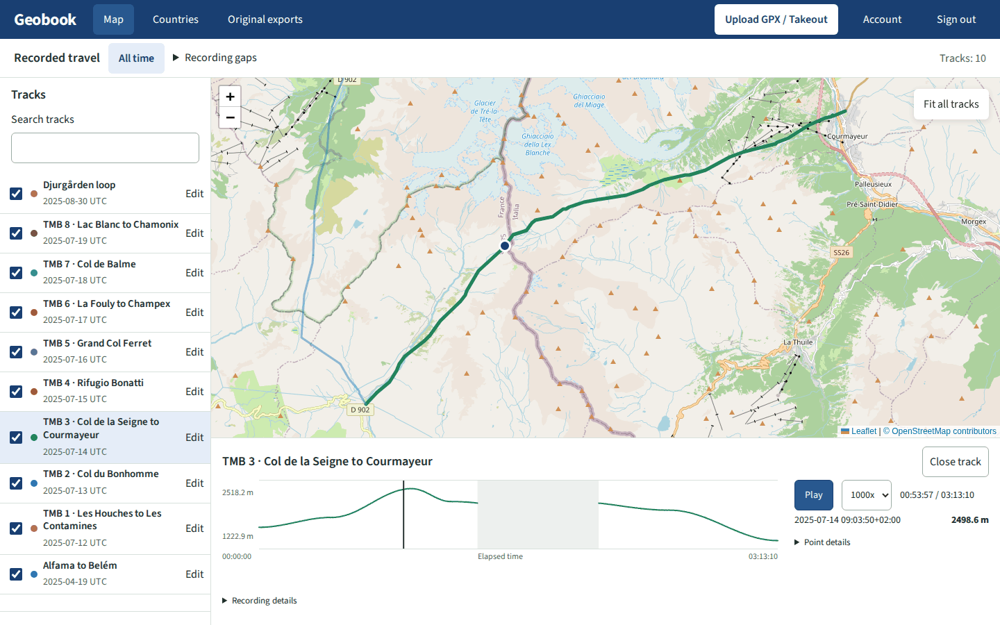
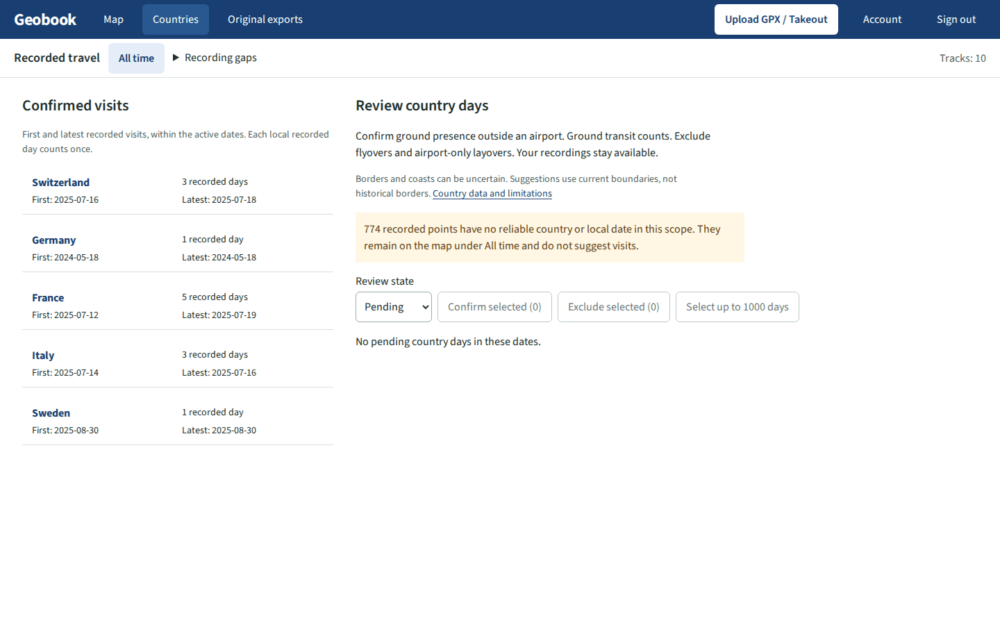
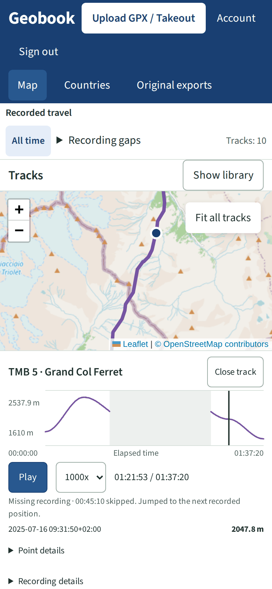

# Geobook

Geobook keeps a personal record of where you have travelled and when. Upload the
GPS tracks you record on your phone, and your old Google location history if you
have it, then browse them on a map by date and country or replay a single day.
It runs on your own machine, a Raspberry Pi is enough, and keeps your data in one
directory you control.



## What it does

- Imports GPX 1.0 and 1.1 files, one at a time or many at once. Exports from
  [Organic Maps](https://organicmaps.app) are what it is tested with. A file with
  several recordings becomes several tracks, and uploading the same file twice
  changes nothing.
- Imports location history from a Google Takeout archive (`.zip` or `.tgz`). Each
  day becomes a history day, kept apart from your recorded tracks, with the places
  Google says you visited.
- Shows everything on an OpenStreetMap map. Filter by a date range or a year.
  Dates follow the local time where each point was recorded, so an evening in
  Tokyo stays on the right day.
- Replays one track at up to 1000x speed, with an elevation plot that follows the
  marker. Gaps in a recording are shown as gaps and skipped, not drawn as travel.
- Suggests which countries you were in on which days. You confirm or exclude each
  one, and the Countries page lists first visit, latest visit and number of days.
- Keeps every uploaded file byte for byte, so you can download the original or
  delete it later.

| Playback | Countries | Phone |
| --- | --- | --- |
|  |  |  |

## Quick start

You need a Linux host (x86-64 or ARM64) with Docker Engine and the Compose plugin.

```sh
mkdir geobook && cd geobook
curl -fsSLO https://raw.githubusercontent.com/ahemberg/geobook/v0.0.1/compose.yaml
curl -fsSL -o .env https://raw.githubusercontent.com/ahemberg/geobook/v0.0.1/.env.example
sudo install -d -m 0750 -o 10001 -g 10001 /srv/geobook
```

Edit `.env` and set three values:

```sh
GEOBOOK_IMAGE=ghcr.io/ahemberg/geobook:0.0.1
GEOBOOK_DATA_DIRECTORY=/srv/geobook
GEOBOOK_OWNER_PASSWORD=choose-a-long-password
```

Then start it:

```sh
docker compose up -d
```

Open http://localhost:8080 and sign in as `admin` with that password. The
password is stored on first start. Changing it in `.env` later does nothing, so
change it from the Account page.

By default Geobook only listens on `127.0.0.1`. To reach it from your phone or
another computer, set `GEOBOOK_BIND_ADDRESS` to the host's LAN or VPN address
and run `docker compose up -d` again.

## Using it

1. **Upload.** Click *Upload GPX / Takeout* and pick one or more files. Each file
   shows its progress, duplicates and warnings, such as points with no time.
2. **Browse.** The library on the left lists tracks newest first. Tick tracks on
   or off, rename them or change their colour. These choices are saved on the
   server, so your phone sees the same map as your laptop.
3. **Replay.** Click a track to open it below the map. Press *Play*, pick a speed
   or drag along the elevation plot.
4. **Review countries.** Open *Countries*, confirm the days you were really there
   and exclude the rest, such as a flight over a country or a layover at its
   airport. Only confirmed days are counted.

To get a Google Takeout archive, select *Location History (Timeline)* at
[takeout.google.com](https://takeout.google.com). Geobook reads `Records.json` and
the *Semantic Location History* folder. Since 2024 Google keeps Timeline on the
phone instead, and the export from the phone's Timeline settings is a different
format that Geobook does not read yet.

## Self-hosting

[docs/deployment.md](docs/deployment.md) is the full guide. The short version:

- **Network.** Geobook is built for one person on a home network or VPN. Read
  [authentication](docs/deployment.md#authentication) before putting it on the
  internet, and [reverse proxy](docs/deployment.md#behind-a-reverse-proxy) if you
  run one in front of it. Two-factor sign-in is available from the Account page.
- **Scripts.** Upload from a script or phone shortcut with an
  [app password](docs/deployment.md#app-passwords) instead of your own password.
- **Map tiles.** Tiles come from openstreetmap.org by default. Set
  `GEOBOOK_TILES_URL` and the attribution variables in `.env` to use another
  provider.
- **Storage.** Everything lives in the data directory: a SQLite database and
  your original files. Put it on a local disk, not a network share, and run only
  one Geobook against it.
- **Updates.** Check the [release notes](docs/release-notes.md), back up, and copy
  the new release's `compose.yaml`. Add any new `.env.example` settings to your
  existing `.env`, change `GEOBOOK_IMAGE`, then pull and recreate the container.
  Follow the [manual update steps](docs/deployment.md#explicit-manual-updates).
- **Backups.** Stop the container and copy the data directory. See
  [copy and restore](docs/deployment.md#stopped-app-copy-and-restore).

## Development

Geobook is a Spring Boot application with a React frontend, built together by
Maven into one jar and one container image. It needs JDK 27; Maven fetches Node
itself. Run `./mvnw verify` to build and test everything. [docs/development.md](docs/development.md)
covers the build checks, running from source and the test scripts.

## License

[MIT](LICENSE)
